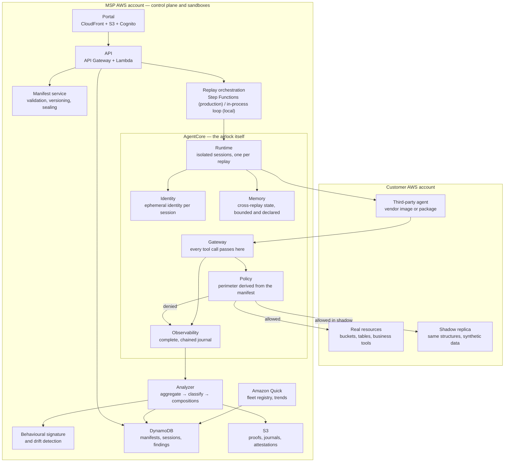

# Sas — Architecture

> Submission deliverable (§29): the diagram is a Mermaid graph (below) plus an
> exported SVG (`docs/architecture.svg`). The graph reproduces spec §20.1 and is
> annotated with what is actually implemented versus designed. Legend follows.

## 1. Diagram (Mermaid)

**Status overlay** (what is actually in the repository → `docs/HLD.md` §9):

* **Real, offline, tested** (local AgentCore backend + orchestration):
  `manifeste/`, `ombre/`, `scenarios{,.py}`, `demo/agents/`, `agentcore/local.py`,
  `agentcore/passerelle.py`, `agentcore/politique_manifeste.py`,
  `agentcore/observabilite.py`, `orchestrateur/campagne.py`, `sessions.py`,
  `journal/chaine.py`, `analyseur/{agregation,classification}.py`,
  `compositions/detecteur.py` + `regles/compositions.yaml`, `ecarts.py`
  (broken, see below), `statistiques.py`, `couts.py`, `rapports/{verdict,attestation}.py`,
  `store/{base,ddl,local,integrite}.py`, `arret.py`.
* **Port only, no adapter:** `ModeleAnalyse` (Bedrock), `AnalyseurAcces`
  (IAM Access Analyzer).
* **Design only / not in the tree:** `agentcore/aws.py`, `api/`, `portail/`,
  `portal/`, `registre.py`, `signature/`, `observe/`, `modeles/`, `eval/`,
  `infra/cdk/`, `infra/quick/`, `lambdas/`, `cli_smoke.py`, `cli_demo.py`.
* **Known defect:** `sas.ecarts.calculer()` crashes when a gap exists
  (keyword mismatch against the frozen `Ecart` dataclass); `sas.compositions`
  default rules path points at `src/regles/` instead of `regles/`.

## 2. Component legend

| Node | What it does | Code / status |
|---|---|---|
| **Runtime** | one isolated session per replay, bounded in time and resources | `agentcore/local.py::RuntimeLocal` (real); real AgentCore = lot 17 |
| **Identity** | one ephemeral identity per session, revocation cuts credentials | `agentcore/local.py::IdentityLocal` (real) |
| **Policy** | the perimeter derived from the manifest, applied **before** the tool | `agentcore/politique_manifeste.py::PolicyLocale` (real) |
| **Gateway** | the single choke point for every tool call; journals allowed *and* denied | `agentcore/passerelle.py::GatewayLocal` (real) |
| **Memory** | cross-replay state only when declared; reset between replays otherwise | `agentcore/local.py::MemoryLocal` (real) |
| **Observability** | complete, chained, immutable, exportable journal + measured cost | `agentcore/observabilite.py` (real) |
| **Analyzer** | pass 1 deterministic aggregation, pass 2 model proposal (port only), pass 3 code decision | `analyseur/agregation.py`, `analyseur/classification.py` |
| **Behavioural signature** | weighted signature + drift distance | design only (`signature/` absent) |
| **Manifest service** | schema, validation, versioning, HMAC seal | `manifeste/` (real) |
| **Portal / API** | static portal + API Gateway/Lambda | design only (`api/`, `portail/`, `portal/` absent) |
| **DynamoDB / S3** | persistence and evidence | `store/ddl.py` (definitions), `store/local.py` (in-memory), real DynamoDB = lot 17 |
| **Amazon Quick** | fleet registry and trends | design only (`infra/quick/` absent) |

## 3. The campaign flow (§11.1)

Implemented step by step in `src/sas/orchestrateur/campagne.py` and
`src/sas/orchestrateur/sessions.py` (the ten steps of §11.1):

1. the client architect writes the manifest; the editor seals it
   (`sas/manifeste/signature.py`);
2. Sas validates the manifest: permission grain, budget coherence, scenarios
   (`sas/manifeste/validation.py`) — an invalid manifest is refused with a
   correction list;
3. the sponsor validates the perimeter and authorizes the homologation;
4. Sas builds the shadow environment: replica of the declared resources,
   synthetic data, marked decoys (`sas/ombre/generateur.py`);
5. the agent is executed on each scenario, N times, in isolated sessions with an
   ephemeral identity (`orchestrateur/sessions.py::executer_rejeu`);
6. every tool call passes through Policy: allowed, denied, or allowed under
   condition; everything is journalled with its causal chain
   (`passerelle.py`, `politique_manifeste.py`);
7. the analyzer computes the behaviour envelope, the declared/observed gap, the
   detected compositions and the classification of attempts
   (`analyseur/`, `compositions/`, `ecarts.py`);
8. ambiguous cases go to human review;
9. the report and the dated attestation are produced (`rapports/`);
10. three possible outcomes: **homologué**, **homologué sous conditions**,
    **refusé** (`rapports/verdict.py`).

## 4. The central architectural principle (§20.3)

**The policy is derived from the manifest, never written by hand.**

`src/sas/agentcore/politique_manifeste.deriver()` is the only entry point to
the perimeter policy. It maps the manifest's tools, data and outputs onto the
shadow replica, emits every rule with `origine = "manifeste"`, and fingerprints
the result. The manifest is the single source: it produces the applied policy
and the comparison baseline together, so a modified manifest changes the
perimeter and the reference in the same gesture — there is no state where the
two can diverge. Test R4 asserts exactly this (`tests/unit/manifeste/test_recette.py`).